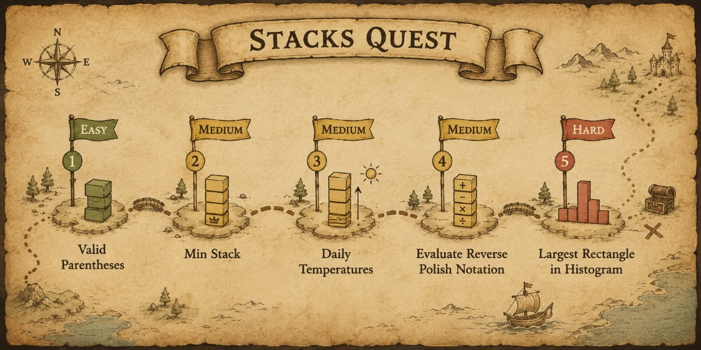

# Stack Pattern Problems

Five stack-based problems worked through progressively, easy → hard, building the monotonic-stack
intuition step by step:

1. [Valid Parentheses](./01-valid-parentheses) — matching ([LC 20](https://leetcode.com/problems/valid-parentheses/))
2. [Min Stack](./02-min-stack) — augmented state ([LC 155](https://leetcode.com/problems/min-stack/))
3. [Evaluate Reverse Polish Notation](./03-evaluate-rpn) — expression evaluation ([LC 150](https://leetcode.com/problems/evaluate-reverse-polish-notation/))
4. [Infix → Postfix → Evaluate (Tokenizer)](./04-infix-to-postfix-tokenizer) — Shunting-Yard, the "other half" of RPN (related: [LC 224](https://leetcode.com/problems/basic-calculator/), [LC 227](https://leetcode.com/problems/basic-calculator-ii/))
5. [Daily Temperatures](./05-daily-temperatures) — monotonic stack ([LC 739](https://leetcode.com/problems/daily-temperatures/))
6. [Largest Rectangle in Histogram](./06-largest-rectangle-histogram) — monotonic stack, harder ([LC 84](https://leetcode.com/problems/largest-rectangle-in-histogram/))

Each directory has its own `README.md` with the problem description, approach, and complexity, plus
a TypeScript solution file (directory 4 has multiple files for the tokenize → convert → evaluate pipeline).